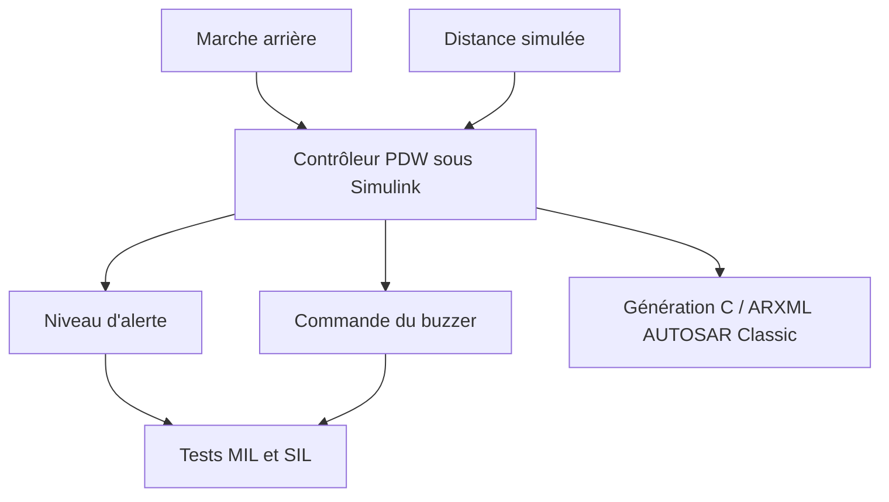

# Parking Distance Warning (PDW) — MATLAB/Simulink & AUTOSAR Classic


## Présentation du projet

Ce dépôt présente la conception, la modélisation, la génération de code et la validation d'un **système d'aide au stationnement par avertissement de distance (Parking Distance Warning — PDW)**.

Le système surveille la distance entre l'arrière d'un véhicule et un obstacle lorsque la **marche arrière** est engagée. Il classe la proximité en niveaux d'alerte et commande un avertissement sonore adapté.

L'objectif est de mettre en pratique une démarche de développement de logiciel embarqué automobile autour de **MATLAB/Simulink**, **AUTOSAR Classic**, des tests **Model-in-the-Loop (MIL)** et **Software-in-the-Loop (SIL)**.

> **Périmètre :** prototype académique de simulation. Les seuils et les fréquences d'alerte sont des paramètres de conception du projet ; ils ne constituent pas une preuve de conformité à une réglementation ou à une norme constructeur.

## Fonctionnement du PDW

Le contrôleur reçoit principalement :

- l'état de la marche arrière (`ReverseGearInput`) ;
- une distance à l'obstacle issue d'un capteur simulé.

Lorsque la marche arrière est activée, il calcule un **niveau d'avertissement** et un **signal de buzzer** selon la distance mesurée.

| Distance à l'obstacle | Niveau | Avertissement sonore |
|---|---|---|
| `d > 1,50 m` | 0 — Aucun danger détecté | Aucun signal |
| `0,80 m < d ≤ 1,50 m` | 1 — Attention | Bips lents (~1 Hz) |
| `0,30 m ≤ d ≤ 0,80 m` | 2 — Proximité importante | Bips rapides (~5 Hz) |
| `d < 0,30 m` | 3 — Très proche | Signal continu |

Les valeurs aux frontières doivent être interprétées selon les comparateurs effectivement configurés dans les modèles Simulink. La plage de distance utilisée pour la simulation est **0 à 4 m** ; les données hors plage et non valides doivent être traitées selon la logique du modèle.

## Architecture fonctionnelle



### Intégration AUTOSAR Classic

Le contrôleur est étudié comme un **Software Component (SWC)** AUTOSAR Classic :

- **Runnable périodique :** `PDW_Main_20ms` ;
- **Période d'exécution :** `20 ms` (`0,02 s`) ;
- **Entrée :** `ReverseGearInput` ;
- **Sorties :** `WarningLevelOutput` et `BuzzerOutput` ;
- **Artefacts générés :** fichiers C/H et descriptions AUTOSAR au format ARXML.

La période de 20 ms correspond au choix de cadence du contrôleur dans ce prototype. Elle ne représente pas à elle seule une exigence imposée par AUTOSAR.

## Validation du système

### Model-in-the-Loop (MIL)

Le comportement est testé directement au niveau des modèles Simulink. Les scénarios de validation couvrent les différents niveaux d'avertissement, l'activation par marche arrière et des cas limites.

**Résultat obtenu dans le projet : 12 tests MIL sur 12 validés.**

### Software-in-the-Loop (SIL)

Les essais SIL servent à confronter le comportement du logiciel compilé à celui du modèle de référence, sur des scénarios comparables.

**Résultat obtenu dans le projet : 12 tests SIL sur 12 validés**, avec concordance MIL/SIL sur les cas testés.

Le fichier `PDW_MIL_SIL_results.csv` et les scripts de comparaison permettent de consulter les résultats disponibles dans ce dépôt.

### Simulation dynamique et visualisation 3D

Le projet a également étudié une approche dynamique (véhicule reculant vers un obstacle) et une visualisation dans **Unity**, avec des échanges envisagés ou développés autour de **ROS 2**. Le dépôt actuel contient le script `export_pdw_unity.m`, mais **ne contient pas nécessairement** la scène Unity ni l'environnement ROS 2 complet. Cette partie n'est donc pas reproductible à partir de ce dépôt seul.

## Contenu du dépôt

```text
PDW-AUTOSAR-Classic/
├── PDW_Controller.slx                  # Modèle principal du contrôleur PDW
├── PDW_Controller_CP1.slx              # Variante du contrôleur
├── PDW_System.slx                      # Modèle système
├── PDW_System_F04.slx                  # Variante / scénario système
├── PDW_TestBench.slx                   # Banc de test
├── PDW_TestBench_SIL.slx               # Banc de test SIL
├── test_mil.m                          # Script de tests MIL
├── test_sil.m                          # Script de tests SIL (si présent dans la version publiée)
├── compare_mil_sil.m                   # Comparaison MIL/SIL
├── compare_all_mil_sil.m               # Comparaison étendue
├── export_pdw_unity.m                  # Script lié à la visualisation Unity
├── PDW_MIL_SIL_results.csv             # Résultats de tests
├── PDW_Controller_autosar_rtw/
│   ├── PDW_Controller.c                # Code C généré
│   ├── PDW_Controller.h                # Interface C générée
│   ├── PDW_Controller_component.arxml  # Description du composant AUTOSAR
│   ├── PDW_Controller_datatype.arxml   # Types de données AUTOSAR
│   ├── PDW_Controller_interface.arxml  # Interfaces AUTOSAR
│   └── PDW_Controller_implementation.arxml
├── .gitignore
└── README.md
```

**Note :** les répertoires de compilation, fichiers objets, exécutables et caches de simulation sont volontairement ignorés par Git. Certains fichiers `.mat` nécessaires à une reproduction complète pourraient également ne pas être inclus.

## Environnement de développement

- **MATLAB R2022b** et **Simulink** ;
- **AUTOSAR Blockset** pour le modèle de composant et la génération ARXML ;
- Outils de génération de code compatibles pour produire les artefacts C ;
- Compilateur C/C++ pris en charge par MATLAB pour les tests SIL (configuration utilisée : **MinGW-w64**) ;
- **Unity** et **ROS 2** pour les expérimentations de visualisation et de communication (hors reproduction minimale du dépôt).

## Démarrage

1. Cloner le dépôt :

   ```bash
   git clone https://github.com/gaddour-chaima/PDW-AUTOSAR-Classic.git
   ```

2. Ouvrir MATLAB R2022b et placer le dossier cloné dans le chemin de travail.
3. Ouvrir `PDW_Controller.slx` pour examiner la logique de contrôle.
4. Ouvrir `PDW_TestBench.slx` pour examiner les scénarios de simulation.
5. Examiner les scripts `test_mil.m`, `compare_mil_sil.m` et `compare_all_mil_sil.m` avant exécution, et adapter leurs chemins ou dépendances locales si nécessaire.
6. Consulter `PDW_Controller_autosar_rtw/` pour le code C et les fichiers ARXML générés.

> **Reproductibilité :** les modèles peuvent dépendre de paramètres, fichiers locaux ou configurations de toolbox qui ne sont pas tous versionnés. Vérifier les dépendances dans MATLAB avant d'exécuter les tests et de régénérer le code.

## Objectifs techniques

- Concevoir une logique d'assistance au stationnement fondée sur la distance à un obstacle.
- Développer et simuler le contrôleur dans Simulink.
- Structurer le contrôleur selon les concepts d'AUTOSAR Classic.
- Générer du code C et des fichiers de description ARXML.
- Vérifier la cohérence des résultats au moyen des tests MIL et SIL.
- Explorer une visualisation dynamique du système dans un environnement 3D.

## Perspectives

- Renforcer la gestion des valeurs aberrantes et des défauts de capteurs.
- Étendre les scénarios de validation et automatiser leur exécution.
- Ajouter les éléments nécessaires à une reproduction complète de la simulation Unity / ROS 2.
- Étudier une intégration matérielle et des essais **Hardware-in-the-Loop (HIL)**.

## Licence

Aucune licence de réutilisation n'est actuellement déclarée pour ce dépôt. Les droits de réutilisation restent réservés à leurs titulaires jusqu'à l'ajout éventuel d'un fichier `LICENSE`.
